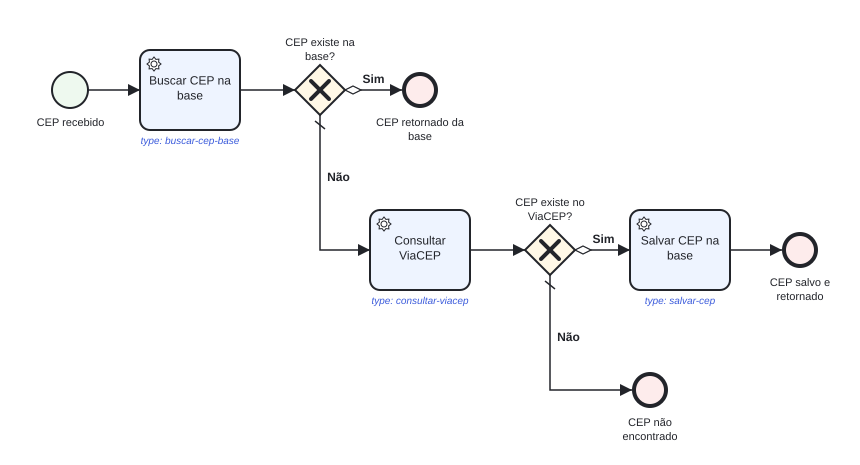

# camunda-cep-workflow

Projeto de estudo de **Camunda 8 + Spring Boot 4**: uma API de consulta de CEP em que a lógica do fluxo não fica no código Java. Ela fica em um processo **BPMN** executado pelo Camunda.

> Busca o CEP na base local → se não existir, consulta o [ViaCEP](https://viacep.com.br) → se o ViaCEP encontrar, salva na base e retorna → se ninguém encontrar, retorna um CEP vazio.

## Sumário

- [O que é o Camunda?](#o-que-é-o-camunda)
- [Propósito do projeto](#propósito-do-projeto)
- [O processo `process-cep`](#o-processo-process-cep)
- [Camunda 7 x Camunda 8: do JavaDelegate ao Job Worker](#camunda-7-x-camunda-8-do-javadelegate-ao-job-worker)
  - [Quem decide a ordem é o BPMN, não o Java](#quem-decide-a-ordem-é-o-bpmn-não-o-java)
- [Como Spring e Camunda conversam neste projeto](#como-spring-e-camunda-conversam-neste-projeto)
- [Organização dos workers (boas práticas)](#organização-dos-workers-boas-práticas)
- [Tecnologias e estrutura](#tecnologias)
- [Como rodar](#como-rodar)
- [Experimento: provocando um incident](#experimento-provocando-um-incident)
- [Rastreio: onde e quando a mensagem passou](#rastreio-onde-e-quando-a-mensagem-passou)

---

## O que é o Camunda?

O [Camunda](https://camunda.com) é uma plataforma de **orquestração de processos**. Você desenha o fluxo do negócio em **BPMN 2.0**, o padrão visual de "caixinhas e setas", e o Camunda **executa** esse desenho:

- guarda o **estado** de cada execução (*instância de processo*);
- decide os caminhos nos **gateways** com base nas variáveis do processo;
- controla esperas, tentativas de novo (*retries*) e erros (*incidents*);
- mostra tudo em tempo real em uma interface web.

O desenho deixa de ser só documentação: **ele é o código que roda**. Quem olha o diagrama vê exatamente o que acontece em produção.

## Propósito do projeto

Aprender, com um caso simples e real, como Spring e Camunda se comunicam:

- modelar um processo BPMN com service tasks e gateways exclusivos;
- implementar **job workers** em Spring, um por caixinha;
- iniciar processos e **esperar o resultado** a partir de um endpoint REST;
- acompanhar as instâncias no **Operate** (caminho percorrido, variáveis e incidents);
- observar retries e **incidents** quando uma integração externa (ViaCEP) falha.

---

## O processo `process-cep`

Arquivo: [`src/main/resources/bpmn/process-cep.bpmn`](src/main/resources/bpmn/process-cep.bpmn). Abre no [Camunda Modeler](https://camunda.com/download/modeler/) para edição visual.

> A imagem abaixo é gerada a partir do próprio `.bpmn` (as coordenadas da seção `<bpmndi:BPMNDiagram>`). Sempre que alterar o processo, gere de novo:
> ```bash
> python3 docs/render_bpmn.py
> ```
> O script usa só a biblioteca padrão do Python 3, não precisa instalar nada.



**Como ler o desenho**

| Símbolo | Elemento BPMN | Neste processo |
|---|---|---|
| ○ círculo fino | *Start event* | "CEP recebido": a instância nasce quando o endpoint é chamado |
| ▭ retângulo com engrenagem | *Service task* | Uma caixinha executada por um **job worker**. O `type:` em azul é o que liga a caixinha ao Java |
| ◇ losango com X | *Exclusive gateway* (XOR) | Escolhe **um** caminho com base numa expressão FEEL |
| ⬭ losango pequeno na seta | Fluxo condicional | `=encontradoNaBase = true` / `=encontradoNoViaCep = true` |
| traço na seta | Fluxo *default* | Seguido quando nenhuma condição é verdadeira ("Não") |
| ● círculo grosso | *End event* | Fim da instância; o endpoint recebe o resultado |

**Os três caminhos possíveis**

| Caminho | Caixinhas executadas |
|---|---|
| CEP já está na base | Buscar na base |
| Não está na base, ViaCEP encontra | Buscar na base → Consultar ViaCEP → Salvar na base |
| Não encontrado em lugar nenhum | Buscar na base → Consultar ViaCEP |

**Variáveis do processo**

| Variável | Quem define | Uso |
|---|---|---|
| `cep` | endpoint (início do processo) | entrada, só os 8 dígitos |
| `encontradoNaBase` | `BuscarCepBaseWorker` | condição do 1º gateway |
| `encontradoNoViaCep` | `ConsultarViaCepWorker` | condição do 2º gateway |
| `endereco` | workers | resultado devolvido pela API (vazio quando não encontrado) |

---

## Camunda 7 x Camunda 8: do JavaDelegate ao Job Worker

Quem estudou Camunda 7 lembra que **cada caixinha era uma classe Java que implementava `JavaDelegate`**, e o BPMN apontava para essa classe. No Camunda 8 isso mudou: as caixinhas viraram **Job Workers**. A mudança mais importante, porém, é que **o motor saiu de dentro da aplicação**.

### Como funcionava o motor antigo (Camunda 7)

O motor era uma **biblioteca Java** que rodava **dentro da sua aplicação**, na mesma JVM. Ele guardava o estado das instâncias num banco relacional (as tabelas `ACT_*`), e o **Cockpit** lia esse mesmo banco.

```
┌──────────────────── Aplicação Spring Boot (1 JVM) ────────────────────┐
│                                                                        │
│  REST Controller ──► RuntimeService.startProcessInstanceByKey(...)     │
│                                    │                                   │
│                          ┌─────────▼──────────┐                        │
│                          │  Motor Camunda 7   │── chama direto ──►  JavaDelegate.execute()
│                          │   (biblioteca)     │                        │
│                          └─────────┬──────────┘                        │
│                                    │ mesma transação JDBC              │
└────────────────────────────────────┼───────────────────────────────────┘
                                     ▼
                     Banco relacional (tabelas ACT_*)  ◄── Cockpit
```

O BPMN referenciava a **classe** (ou o bean Spring) diretamente:

```xml
<!-- Camunda 7 -->
<bpmn:serviceTask id="Task_BuscarCepBase" name="Buscar CEP na base"
                  camunda:delegateExpression="${buscarCepBaseDelegate}" />
<!-- ou: camunda:class="com.exemplo.BuscarCepBaseDelegate" -->
```

```java
// Camunda 7: a caixinha é uma classe que implementa JavaDelegate
@Component("buscarCepBaseDelegate")
public class BuscarCepBaseDelegate implements JavaDelegate {

    @Autowired
    private CepService cepService;

    @Override
    public void execute(DelegateExecution execution) {
        String cep = (String) execution.getVariable("cep");
        Optional<CepResponse> endereco = cepService.buscarNaBase(cep);

        execution.setVariable("encontradoNaBase", endereco.isPresent());
        endereco.ifPresent(e -> execution.setVariable("endereco", e));
    }
}
```

Características:
- **Chamada direta**: o motor chamava `execute()` no mesmo processo, e o delegate tinha acesso a tudo da execução (`DelegateExecution`).
- **Transação compartilhada**: se o delegate lançasse exceção, a transação inteira era desfeita e a instância **voltava para o último ponto de espera** (*wait state*).
- **Acoplamento**: o BPMN dependia de uma classe Java. Renomear a classe quebrava o processo.

> O Camunda 7 também tinha as **External Tasks** (`camunda:type="external"` com um `camunda:topic`), em que um serviço externo buscava o trabalho. No Camunda 8, esse modelo virou **o único**.

### Como funciona o motor atual (Camunda 8 / Zeebe)

O motor (**Zeebe**) é um **servidor separado**, que aqui roda no Docker. Ele guarda o estado em um log próprio (não usa as suas tabelas). O **Operate** é a interface de acompanhamento, equivalente ao Cockpit. Sua aplicação é um **cliente** que conversa com o Zeebe pela rede (gRPC/REST).

```
┌──────────── Aplicação Spring Boot ────────────┐            ┌──────── Camunda 8 (Docker) ────────┐
│                                               │            │                                    │
│ CepController                                 │            │                                    │
│   └► CepProcessService                        │  1. cria   │   Zeebe (motor)                    │
│        camundaClient.newCreateInstanceCommand │──instância─►   • gateways, estado, retries      │
│        ...withResult()  ◄─────────────────────│◄─5. result─│   • cria um JOB por service task   │
│                                               │            │                                    │
│ BuscarCepBaseWorker   @JobWorker(type=...)    │◄─2. busca──│   job "buscar-cep-base"            │
│ ConsultarViaCepWorker @JobWorker(type=...)    │   jobs     │   job "consultar-viacep"           │
│ SalvarCepWorker       @JobWorker(type=...)    │──3. completa► job "salvar-cep"                  │
│        │                                      │  + variáveis│                                   │
│        ▼                                      │            │   Operate ◄── lê o estado          │
│   CepService ──► H2 / ViaCEP                  │            │   http://localhost:8080/operate    │
└───────────────────────────────────────────────┘            └────────────────────────────────────┘
                     4. o motor segue o fluxo (gateway → próximo job ...)
```

O BPMN não referencia mais Java. Ele só declara **um tipo de trabalho** (um texto):

```xml
<!-- Camunda 8 -->
<bpmn:serviceTask id="Task_BuscarCepBase" name="Buscar CEP na base">
  <bpmn:extensionElements>
    <zeebe:taskDefinition type="buscar-cep-base" retries="3" />
  </bpmn:extensionElements>
</bpmn:serviceTask>
```

E o worker diz "eu atendo esse tipo" ([`BuscarCepBaseWorker`](src/main/java/com/camunda/cep/workflow/worker/BuscarCepBaseWorker.java)):

```java
// Camunda 8: a caixinha é atendida por um método @JobWorker
@Slf4j
@Component
@RequiredArgsConstructor
public class BuscarCepBaseWorker {

    private final CepService cepService;

    @JobWorker(type = JobTypes.BUSCAR_CEP_BASE)                       // "buscar-cep-base"
    public Map<String, Object> executar(@Variable("cep") String cep) { // lê só a variável "cep"
        return cepService.buscarNaBase(cep)
                .<Map<String, Object>>map(endereco -> Map.of(
                        "encontradoNaBase", true,
                        "endereco", endereco))
                .orElseGet(() -> Map.of("encontradoNaBase", false));  // Map devolvido = novas variáveis
    }
}
```

Na prática:
1. A instância chega na caixinha → o Zeebe cria um **job** do tipo `buscar-cep-base`.
2. O starter do Spring mantém um cliente que **busca jobs** desse tipo (por *polling* ou *streaming*).
3. O método roda. Se terminar normalmente, o job é **completado** com o `Map` como variáveis. Se lançar exceção, o job **falha**, e o Zeebe tenta de novo (`retries`). Quando as tentativas acabam, abre um **incident** no Operate.
4. O Zeebe continua o fluxo sozinho: avalia o gateway e cria o próximo job...

### Quem decide a ordem é o BPMN, não o Java

O Zeebe segue **à risca** o [`process-cep.bpmn`](src/main/resources/bpmn/process-cep.bpmn). Os workers não se chamam entre si e não sabem quem vem antes ou depois: cada um só fica esperando jobs do seu `type`. A ordem em que eles rodam é exatamente a ordem das setas do diagrama:

1. A instância começa → o Zeebe cria **só** o job `buscar-cep-base`. `ConsultarViaCepWorker` e `SalvarCepWorker` ficam ociosos, porque ainda não existe job do tipo deles.
2. Quando `BuscarCepBaseWorker` completa, o Zeebe avalia o gateway (`=encontradoNaBase = true`). Se for verdadeiro, a instância termina e os outros dois workers **nunca** são acionados.
3. Caso contrário, o Zeebe cria o job `consultar-viacep`; e só depois dele, conforme o 2º gateway (`=encontradoNoViaCep = true`), o job `salvar-cep`.

Consequências:
- A ordem das classes, dos métodos ou do registro dos beans no Spring **não influencia nada**.
- Um worker nunca roda "antes da hora": o job dele só existe quando a instância chega na caixinha correspondente.
- Para mudar a ordem, pular ou adicionar uma etapa, altera-se o `.bpmn` (e faz-se o redeploy), não o código dos workers.

### Lado a lado

| | Camunda 7 | Camunda 8 |
|---|---|---|
| Motor | Biblioteca **embutida** na aplicação | Servidor **separado** (Zeebe) |
| Estado | Banco relacional (`ACT_*`) | Log próprio do Zeebe (+ armazenamento secundário para o Operate) |
| Monitoramento | **Cockpit** | **Operate** |
| Caixinha (service task) | Classe `JavaDelegate` | Método `@JobWorker` |
| BPMN referencia | Classe/bean Java (`camunda:class`, `camunda:delegateExpression`) | Só um texto (`zeebe:taskDefinition type="..."`) |
| Quem chama quem | Motor **chama** o delegate | Worker **busca** o job no motor |
| Ordem de execução | Definida pelo BPMN: o motor chama cada delegate na sequência | Definida pelo BPMN: o Zeebe só cria o job da próxima caixinha quando a anterior completa; os workers não se conhecem |
| Ler variáveis | `execution.getVariable("cep")` | `@Variable("cep") String cep` |
| Gravar variáveis | `execution.setVariable(...)` | Retornar um `Map`/objeto do método |
| Iniciar processo | `runtimeService.startProcessInstanceByKey(...)` | `camundaClient.newCreateInstanceCommand()...send()` |
| Deploy do BPMN | Auto-deploy de `src/main/resources` (`@EnableProcessApplication`) | `@Deployment(resources = "classpath:bpmn/...")` |
| Expressões | JUEL: `${encontradoNaBase}` | FEEL: `=encontradoNaBase = true` |
| Erro no código | Rollback até o último *wait state* | Job falha → retries → **incident** |
| Transação com o seu banco | Compartilhada | **Não existe**: o worker deve ser **idempotente** |
| Linguagem dos workers | Java | Qualquer uma (Java, Node, Go, Python, ...) |
| Escala | Escala junto com a aplicação | Motor e workers escalam separadamente |

### O que isso muda no seu código

- **Idempotência é obrigatória.** O Zeebe garante que o job roda **pelo menos uma vez**. Se o worker executar e cair antes de avisar o Zeebe, o job é entregue de novo. Neste projeto, `SalvarCepWorker` usa o CEP como chave (rodar duas vezes só sobrescreve), e os outros dois só fazem leitura.
- **Exceção deixou de ser rollback.** Lançar exceção no worker é a forma de dizer "falhou, tente de novo". Para um erro **de negócio** que o BPMN deve tratar (por exemplo, desviar o fluxo), o caminho é lançar um *BPMN error* (`CamundaError.bpmnError(...)`) e modelar um *error boundary event*.
- **Variáveis são JSON.** Objetos como `CepResponse` são serializados em JSON ao virar variável e desserializados de volta no `@Variable`.

---

## Como Spring e Camunda conversam neste projeto

| Direção | Classe | Mecanismo |
|---|---|---|
| Spring → Camunda (deploy) | [`CamundaCepWorkflowApplication`](src/main/java/com/camunda/cep/workflow/CamundaCepWorkflowApplication.java) | `@Deployment(resources = "classpath:bpmn/process-cep.bpmn")` publica o BPMN na subida |
| Spring → Camunda (iniciar) | [`CepProcessService`](src/main/java/com/camunda/cep/workflow/service/CepProcessService.java) | `newCreateInstanceCommand().withResult()` inicia e **espera** o fim (timeout padrão do client: 10s) |
| Camunda → Spring | [`worker/`](src/main/java/com/camunda/cep/workflow/worker) | Um `@JobWorker` por caixinha |
| Dentro do Camunda | `process-cep.bpmn` | Gateways (FEEL) rodam no Zeebe, sem Java |

```java
// CepProcessService: inicia o processo e aguarda o resultado
ProcessInstanceResult result = camundaClient.newCreateInstanceCommand()
        .bpmnProcessId("process-cep")
        .latestVersion()
        .variables(Map.of("cep", cep))
        .withResult()                     // espera a instância terminar
        .fetchVariables("endereco")       // só traz o que interessa
        .send()
        .join();
```

---

## Organização dos workers (boas práticas)

```
worker/
├── JobTypes.java               # constantes com os "type" do BPMN
├── BuscarCepBaseWorker.java    # caixinha "Buscar CEP na base"
├── ConsultarViaCepWorker.java  # caixinha "Consultar ViaCEP"
└── SalvarCepWorker.java        # caixinha "Salvar CEP na base"
service/
└── CepService.java             # regra de negócio, sem dependência do Camunda
```

| Caixinha no BPMN | `type` | Constante | Worker | Entrada | Saída |
|---|---|---|---|---|---|
| Buscar CEP na base | `buscar-cep-base` | `JobTypes.BUSCAR_CEP_BASE` | `BuscarCepBaseWorker` | `cep` | `encontradoNaBase`, `endereco`? |
| Consultar ViaCEP | `consultar-viacep` | `JobTypes.CONSULTAR_VIACEP` | `ConsultarViaCepWorker` | `cep` | `encontradoNoViaCep`, `endereco` |
| Salvar CEP na base | `salvar-cep` | `JobTypes.SALVAR_CEP` | `SalvarCepWorker` | `endereco` | (nenhuma) |

Práticas adotadas:

1. **Um worker por caixinha.** É o mesmo modelo mental de uma classe `JavaDelegate` por caixinha no Camunda 7. Fica fácil encontrar o código de cada etapa, testar e mudar uma sem mexer nas outras. A documentação do Camunda não impõe isso: agrupar workers bem relacionados numa classe também é aceito, mas separar escala melhor.
2. **Worker fino.** O worker só traduz entre o Camunda e o seu código: lê as variáveis, chama o [`CepService`](src/main/java/com/camunda/cep/workflow/service/CepService.java) e devolve as variáveis. A regra de negócio fica no service, que não sabe que o Camunda existe e pode ser reaproveitado e testado isoladamente.
3. **Tipos centralizados em [`JobTypes`](src/main/java/com/camunda/cep/workflow/worker/JobTypes.java).** O `type` é o único elo entre o BPMN e o Java. Se o texto no `.bpmn` e na constante divergirem, nada quebra na subida: a instância simplesmente **fica parada** na caixinha no Operate, esperando um worker que nunca aparece.
4. **Idempotência**, como explicado acima.

```java
@NoArgsConstructor(access = AccessLevel.PRIVATE)
public final class JobTypes {
    public static final String BUSCAR_CEP_BASE  = "buscar-cep-base";
    public static final String CONSULTAR_VIACEP = "consultar-viacep";
    public static final String SALVAR_CEP       = "salvar-cep";
}
```

---

## Tecnologias

- Java 21, Spring Boot 4.1.2 (Gradle)
- Camunda 8.10 (`camunda-spring-boot-starter`), com Zeebe + Operate via Docker
- Spring Web MVC + `RestClient` (chamada ao ViaCEP)
- Spring Data JPA + H2 (base local de CEPs)
- Lombok

## Estrutura

```
src/main/java/com/camunda/cep/workflow
├── CamundaCepWorkflowApplication.java   # @Deployment do BPMN
├── api/
│   ├── CepController.java               # GET /ceps/{cep}
│   ├── ExecucaoController.java          # GET /execucoes/pendentes, /execucoes/{id}, /ceps/{cep}/execucoes
│   └── dto/                             # CepResponse (resposta e variável "endereco") + ExecucaoResponse
├── service/
│   ├── CepProcessService.java           # Spring → Camunda (inicia o processo e espera o fim)
│   └── CepService.java                  # regras de negócio (base + ViaCEP), sem dependência do Camunda
├── worker/                              # Camunda → Spring: um @JobWorker por caixinha do BPMN
│   ├── JobTypes.java
│   ├── BuscarCepBaseWorker.java
│   ├── ConsultarViaCepWorker.java
│   ├── SalvarCepWorker.java
│   └── RastreioJob.java                 # atualiza a cep_execucao a cada caixinha
├── execucao/                            # estado de cada execução (tabela cep_execucao) + monitor de paradas
├── client/                              # ViaCepClient (RestClient) + ViaCepResponse
├── domain/Cep.java                      # entidade JPA (com rastreio_id e salvo_em)
└── repository/CepRepository.java
src/main/resources
├── application.yaml
└── bpmn/process-cep.bpmn
src/test/java/com/camunda/cep/workflow
├── CepApplicationTests.java             # contexto Spring sem precisar do Docker
├── CepFixtures.java                     # dados de teste
├── service/CepServiceTest.java
└── worker/                              # um teste por worker
docs/
├── process-cep.svg                      # imagem do processo (gerada)
└── render_bpmn.py                       # gera o SVG a partir do .bpmn
docker-compose.yaml                      # Camunda 8 (Zeebe + Operate)
```

---

## Como rodar

### Pré-requisitos
- Java 21
- Docker com Docker Compose

O Gradle não precisa ser instalado, o projeto usa o wrapper `./gradlew`.

### 1. Subir o Camunda

```bash
docker compose up -d
```

Aguarde o container `orchestration` ficar *healthy* (`docker ps`), o que leva cerca de 30 a 60s.

| Serviço | Endereço |
|---|---|
| **Operate** | http://localhost:8080/operate (usuário `demo`, senha `demo`) |
| Tasklist | http://localhost:8080/tasklist |
| API gRPC (usada pela aplicação) | `localhost:26500` |

### 2. Subir a aplicação

```bash
./gradlew bootRun
```

A aplicação sobe na porta **8081**, porque a 8080 é do Camunda. No log devem aparecer o deploy e os 3 workers:

```
Deployed Processes: <process-cep:1>
Starting job worker: buscarCepBaseWorker#executar with type buscar-cep-base
Starting job worker: consultarViaCepWorker#executar with type consultar-viacep
Starting job worker: salvarCepWorker#executar with type salvar-cep
```

### 3. Testar

```bash
# 1ª vez: não está na base → ViaCEP → salva
curl http://localhost:8081/ceps/01001000

# 2ª vez: já está na base. Aceita hífen.
curl http://localhost:8081/ceps/01001-000

# CEP inexistente: retorna objeto vazio
curl http://localhost:8081/ceps/99999999

# Formato inválido: 400, nem inicia o processo
curl http://localhost:8081/ceps/123
```

Resposta de exemplo:

```json
{
  "cep": "01001000",
  "logradouro": "Praça da Sé",
  "complemento": "lado ímpar",
  "bairro": "Sé",
  "localidade": "São Paulo",
  "uf": "SP",
  "ibge": "3550308",
  "ddd": "11"
}
```

Depois de cada chamada, abra o **Operate → Processes → Buscar CEP** para ver as instâncias finalizadas, o caminho que cada uma percorreu e as variáveis. No log da aplicação aparece cada worker sendo chamado:

```
BuscarCepBaseWorker   : [buscar-cep-base] cep=01001000
ConsultarViaCepWorker : [consultar-viacep] cep=01001000
SalvarCepWorker       : [salvar-cep] cep=01001000
```

### 4. Ver a base local (opcional)

http://localhost:8081/h2-console. JDBC URL: `jdbc:h2:file:./data/cepdb`, usuário `sa`, sem senha.

### 5. Rodar os testes

```bash
./gradlew test
```

Os testes não precisam do Docker:

| Teste | O que cobre |
|---|---|
| `BuscarCepBaseWorkerTest` | achou / não achou na base |
| `ConsultarViaCepWorkerTest` | achou / não achou no ViaCEP / falha de rede (a exceção sobe para o Zeebe tentar de novo) |
| `SalvarCepWorkerTest` | repassa para o service com o `rastreioId` e finaliza a execução como `VIACEP` |
| `CepServiceTest` | busca e conversão na base, chamada ao ViaCEP, gravação com `salvo_em` |
| `CepProcessServiceTest` | resultado do processo, timeout (execução continua viva) e Zeebe recusando (`NAO_INICIADO`) |
| `RastreioJobTest` | etapa concluída, falha com retries, falha que vira incident, causa raiz curta |
| `ExecucaoTest` | transições de estado no cenário "caiu, ficou em incident, Retry, concluiu" |
| `ExecucaoServiceIntegrationTest` | schema e consultas contra o H2 de verdade |
| `CepApplicationTests` | contexto do Spring sobe com o client do Camunda desligado |

### Parar tudo

```bash
docker compose down        # para o Camunda (mantém os dados)
docker compose down -v     # para e apaga os dados do Camunda
```

---

## Experimento: provocando um incident

1. Em `application.yaml`, troque `viacep.base-url` por um endereço inválido, por exemplo `http://localhost:9999`.
2. Reinicie a aplicação e consulte um CEP que ainda **não** está na base.
3. O `ConsultarViaCepWorker` lança exceção. O Zeebe tenta de novo 3 vezes e então abre um **incident**: a instância fica marcada em vermelho no Operate, com a mensagem do erro.
4. Corrija a URL, reinicie a aplicação e, no Operate, clique em **Retry** no incident. O processo continua de onde parou.

Esse é um dos principais ganhos de orquestrar com Camunda: o estado não se perde quando algo dá errado.

> O endpoint espera no máximo 10s pelo resultado (padrão do client, ajustável em `camunda.client.request-timeout`). Se a instância ficar presa em um incident, o `curl` recebe um erro 500 por timeout, mas a instância continua viva no Camunda.

---

## Rastreio: onde e quando a mensagem passou

O Operate mostra o histórico de cada instância, mas a aplicação também precisa responder rápido: **o que foi disparado e não terminou, em qual caixinha está, por que parou e quando o CEP foi salvo de fato.**

### Uma linha por execução (`cep_execucao`)

Cada requisição ao endpoint ganha um `rastreioId` (UUID) e **uma** linha em `cep_execucao`. A linha guarda o **estado atual** e vai sendo atualizada conforme a mensagem anda. O histórico detalhado não é duplicado: ele já está no Operate (pelo `process_instance_key`) e nos logs (pelo `rastreioId`, via MDC).

| coluna | significado |
|---|---|
| `rastreio_id` | id da execução; aparece em todos os logs dela |
| `cep`, `process_instance_key` | o que foi pedido e a instância no Operate |
| `status` | `AGUARDANDO` (esperando um worker pegar a próxima caixinha) · `EXECUTANDO` · `FALHANDO` (vai ter retry) · `INCIDENT` (sem retries) · `CONCLUIDO` · `NAO_INICIADO` (Zeebe recusou) |
| `etapa_atual`, `tentativas` | caixinha do BPMN e quantas vezes ela já foi tentada |
| `ultimo_erro` | causa raiz da última falha, curta. **Não é apagada** quando a execução se recupera |
| `resultado` | `BASE`, `VIACEP` ou `NAO_ENCONTRADO` (por qual fim o processo terminou) |
| `solicitado_em`, `atualizado_em`, `finalizado_em` | pedido, último movimento e fim |

Quem atualiza:

1. [`CepProcessService`](src/main/java/com/camunda/cep/workflow/service/CepProcessService.java) cria a linha e manda o `rastreioId` como variável do processo.
2. Cada worker roda a caixinha pelo [`RastreioJob`](src/main/java/com/camunda/cep/workflow/worker/RastreioJob.java), que marca início, fim ou falha. O worker também diz se a sua saída encerra o processo (espelhando os gateways do BPMN): achou na base → `BASE`; ViaCEP não achou → `NAO_ENCONTRADO`; salvou → `VIACEP`.
3. O [`MonitorExecucoesParadas`](src/main/java/com/camunda/cep/workflow/job/MonitorExecucoesParadas.java) roda a cada minuto e loga `WARN Execucao PARADA` para tudo que não terminou e está sem movimento há mais de `cep.execucao.limite-parada` (5 min). Isso pega também o caso em que **nenhum worker pegou o job** (aplicação fora do ar, `type` errado): o status fica `AGUARDANDO` e o `atualizado_em` para de andar.

Na tabela `cep`, cada registro ganhou `rastreio_id` (qual execução o gravou) e `salvo_em`.

A gravação do rastreio nunca derruba o fluxo: se falhar, vira só um `WARN`. Todas as colunas novas aceitam nulo, porque o `ddl-auto: update` não consegue adicionar coluna `NOT NULL` em tabela que já tem linhas.

### Consultando

```bash
curl http://localhost:8081/execucoes/pendentes        # disparado e não terminado (inclui semMovimentoHaSegundos)
curl http://localhost:8081/execucoes/{rastreioId}     # uma execução (o id está nos logs)
curl http://localhost:8081/ceps/01001000/execucoes    # últimas 20 execuções do CEP (inclui duracaoMs)
```

No cenário do [experimento do incident](#experimento-provocando-um-incident), a execução fica assim enquanto está parada:

```json
{ "status": "INCIDENT", "etapaAtual": "Task_ConsultarViaCep", "tentativas": 3,
  "ultimoErro": "ConnectException: Connection refused", "finalizadoEm": null, "semMovimentoHaSegundos": 1800 }
```

Depois do Retry no Operate, a mesma linha vira `CONCLUIDO`/`VIACEP`, com `finalizado_em` e `duracaoMs` (os 30 min parada aparecem aí), e o `ultimoErro` continua mostrando por que ela parou.

Direto no banco (H2 console):

```sql
-- o que está parado e onde
SELECT rastreio_id, status, etapa_atual, tentativas, ultimo_erro, atualizado_em
FROM cep_execucao WHERE finalizado_em IS NULL ORDER BY atualizado_em;

-- quando um CEP foi pedido e quando foi salvo de fato
SELECT c.cep, e.solicitado_em, c.salvo_em, e.ultimo_erro
FROM cep c JOIN cep_execucao e ON e.rastreio_id = c.rastreio_id;
```

---

## Configuração relevante (`application.yaml`)

```yaml
server:
  port: 8081

camunda:
  client:
    mode: self-managed
    grpc-address: http://localhost:26500
    rest-address: http://localhost:8080
    worker:
      defaults:
        max-retries: 3

cep:
  execucao:
    limite-parada: 5m     # sem movimento há mais que isso = WARN "Execucao PARADA"
    verificar-a-cada: PT1M

viacep:
  base-url: https://viacep.com.br
  connect-timeout: 1s   # tempo máximo para abrir a conexão
  read-timeout: 2s      # tempo máximo esperando a resposta
```

Os timeouts do ViaCEP são curtos de propósito: se o serviço travar, a chamada falha rápido, o job falha e o Zeebe tenta de novo. No pior caso são 3 tentativas de ~3s, ainda dentro dos 10s que o endpoint espera pelo resultado.

## Referências

- [Documentação Camunda 8](https://docs.camunda.io/)
- [Camunda Spring Boot Starter](https://docs.camunda.io/docs/apis-tools/camunda-spring-boot-starter/getting-started/)
- [Job workers](https://docs.camunda.io/docs/components/concepts/job-workers/)
- [BPMN no Camunda 8](https://docs.camunda.io/docs/components/modeler/bpmn/)
- [Migrando do Camunda 7 para o 8](https://docs.camunda.io/docs/guides/migrating-from-camunda-7/)
- [ViaCEP](https://viacep.com.br)
